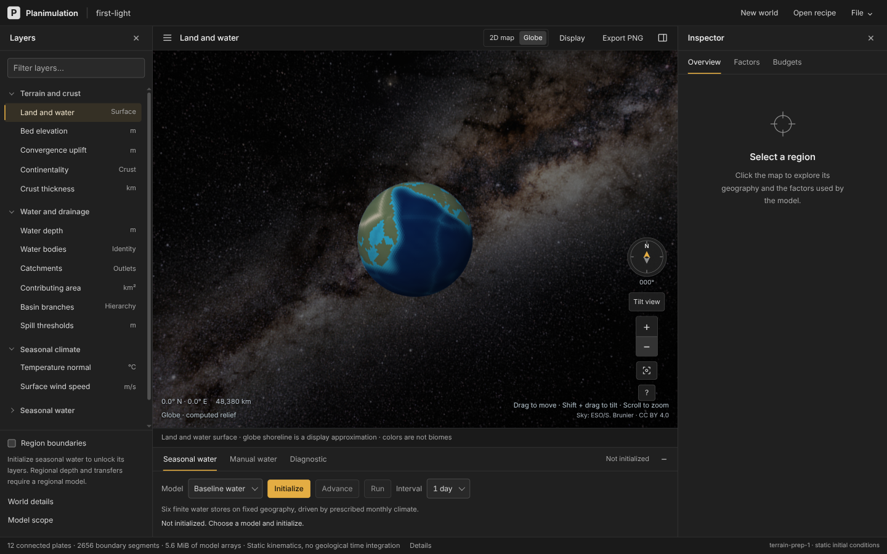
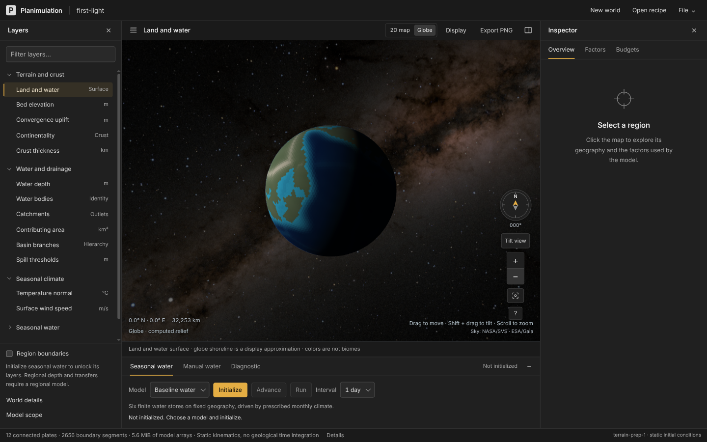
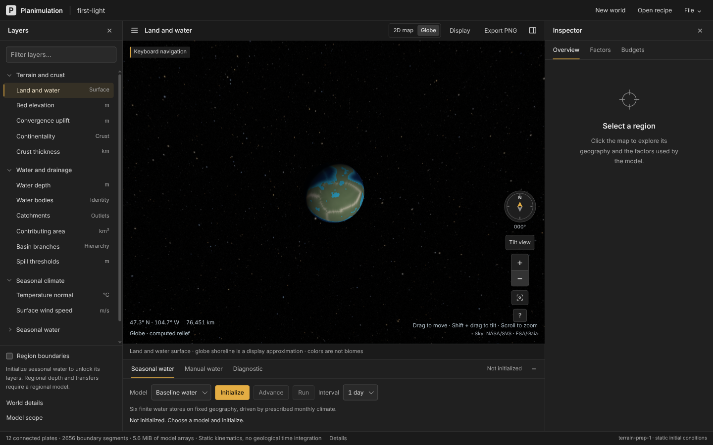

# Planet navigation and space presentation

Date: 2026-10-16. Scope: renderer and navigation only. Recipes, physical fields, clocks, random streams, and checkpoints are unchanged.

## Reference and design plan

The owner requested Google Earth style globe navigation, a compass, and a planet visibly situated in space, using the existing restrained workspace design.

### Sky panorama refinement

The owner subsequently requested the richer space background visible in Google Earth. Google's [space-background announcement](https://blog.google/products-and-platforms/products/earth/stars-in-google-earth-mobile/) identifies ESO imagery of the Milky Way as the reference. The earlier isolated point-star field is insufficient for this direction.

The initial refinement used the licensed [ESO/S. Brunier all-sky panorama](https://www.eso.org/public/images/eso0932a/) with restrained exposure, a visible credit, and source/license information alongside the asset. The panorama supplied star-field structure and dust lanes. Later polar review identified persistent streaks in the mipmapped presentation; the refinement below changes the filtering and asset choice. Preserve a fixed sky orientation while moving the camera; avoid translation parallax and independent animation.

Review against the brief: generic colored procedural nebulae would change the visual language. A real, subdued Milky Way panorama directly follows the requested reference and supplies the missing structure without introducing new interface decoration.

### Projection correction and distant illumination

The owner reported radial star streaks and requested a day/night side visible only when zoomed out. Replace the backdrop sphere with an explicitly reconstructed view ray per screen pixel. Use the plate carrée [Deep Star Maps 2020](https://svs.gsfc.nasa.gov/4851/) galactic map, which is explicitly designed for spherical mapping. The earlier photographic polar mask produced a conspicuous empty area and was rejected during review. Use a single stationary light direction in world space. Blend from readable survey lighting to day/night illumination between camera-to-target distances of three and five reference radii, only on Land and water. For the default 6,371 km radius, this corresponds to 19,113–31,855 km. The near view and analytical layers retain readable lighting. Display settings can disable this effect.

This is a renderer choice, not a rotating-planet model, a physical solar clock, or a change to prescribed seasonal normals. Keep the existing graphite/amber design and avoid invented city lights or extra celestial objects. The atmospheric scattering must follow the same distant light direction as the surface.

Reference: Google's [current globe navigation guide](https://developers.google.com/maps/documentation/earth/navigate-the-globe), [keyboard shortcuts](https://developers.google.com/maps/documentation/earth/use-keyboard-shortcuts), and [desktop navigation guide](https://support.google.com/earth/answer/148186?hl=en). These document drag navigation, cursor-directed zoom, modified dragging for viewpoint changes, true-north reset, and top-down/oblique views. The implementation adapts those interactions to generated geography; it does not use Google's imagery or services.

- Palette: existing graphite `#1a1a1a`, panel `#202020`, divider `#363636`, text `#d4d4d4`, amber `#e4ad43`; space `#040507`. A faint blue atmospheric edge belongs to the globe rendering.
- Type: the existing locally bundled Inter; compact navigation labels, tabular coordinates and distances.
- Layout: retain the persistent layer/map/inspector workspace. Put a compact compass and vertical zoom controls in the lower-right of the viewport. Keep the map toolbar for projection, display, and export.
- Interaction: surface-relative camera with explicit heading, tilt, and target distance. Drag moves geography; modified drag changes heading and tilt. A compass resets heading independently of tilt. Reset view returns to an overview. Flat-map and globe camera poses remain independent.
- Space: a fixed catalogue-derived Milky Way map with restrained exposure and a subtle atmospheric limb. Sparse procedural stars serve as a loading/failure fallback. Day/night lighting at distant zoom is a display effect. There is no animated star drift, invented cloud layer, or unmodeled day/night clock. Rendering remains idle when nothing changes.

Review against the brief: a large flight instrument panel or multicolored compass would compete with the scientific workspace. Use one small compass, existing control shapes, and the existing amber interaction accent. Keep the generated surface as the visual focus. All visual atmosphere and lighting are display effects, not an atmospheric simulation.

## Controls

| Input | Globe | Flat map |
| --- | --- | --- |
| Left drag | Move across the surface | Pan |
| Wheel / pinch | Zoom toward the pointer / gesture center | Zoom toward the pointer |
| Shift or Ctrl/Cmd + left drag; middle drag | Change heading and tilt | Existing pan/zoom controls |
| Right drag | Zoom | Pan |
| Double click | Approach the clicked location | Zoom toward the clicked location |
| Compass click / N | North up, keeping location and tilt | North-up reference |
| Drag compass / compass arrow keys | Adjust heading | North-up reference |
| Tilt control / O | Toggle top-down and oblique view | Unavailable |
| U | Top-down view | North-up reference |
| R / overview control | Overview | Fit map |
| Arrow keys | Move over the surface | Pan |
| Shift + arrows | Heading / tilt | Pan |
| + / −, Page Up / Page Down | Zoom | Zoom |
| Space | Stop camera motion | Stop camera motion |

Keyboard navigation applies to the focused viewport or compass, so typing in controls continues to work normally. Touch uses one finger to move and two fingers to pinch, move, and change heading. Camera clearance follows the rendered relief envelope; camera coordinates are presentation state.

## Implementation

`planet-camera.ts` owns the surface-relative camera, independent heading and tilt, cursor-directed approach, short inertial motion, keyboard commands, and pointer/touch gestures. Motion respects reduced-motion preferences. `map-navigation.ts` presents the compass, view reset, tilt toggle, gesture help, and camera readout. The distance readout is camera-to-target distance expressed using the world's reference radius; it is not terrain elevation or a simulation measurement.

Flat navigation retains OrbitControls with cursor-directed zoom. Camera poses are retained independently when switching projections. The globe uses a reflected display embedding for model Z so east is to the right when north is up, matching the flat projection. The mesh transforms preserve original region IDs and physical arrays.

`space.ts` supplies a locally bundled 4096×2048 all-sky catalogue visualization and a visual atmosphere. Sky exposure increases gradually when zooming out, and its orientation is fixed relative to the world. A full-screen triangle reconstructs the world direction from the inverse camera projection and camera rotation for every fragment. Spherical lookup uses base-level linear filtering and horizontal wrapping. Isotropic mip selection caused excessive radial blur near the spherical poles even with a corrected view ray and a different source map, so sky mipmaps are disabled. The sky ignores camera translation and does not use a backdrop sphere, interpolated sphere UVs, or a polar mask. A deterministic point-star field serves only as a loading/failure fallback and consumes no model randomness. Display settings can independently hide the starry sky and atmosphere. The viewport credit opens the source/usage dialog and stays visible in image exports; [asset attribution](../src/renderer/sky/README.md) records the source and conversion.

`map.ts` blends the surface and water shaders from camera-relative survey lighting to one fixed world-space sun using a smoothstep over distances of 3–5 reference radii. The day/night boundary follows the radial surface direction; a narrow twilight band separates lit and nearly dark hemispheres. Lighting does not rotate on its own. Moving around the globe changes which hemisphere is visible. The Display setting **Day / night from space** disables this blend. The setting is unavailable in the flat map and analytical layers, where the blend is always zero.

The initial Fresnel shell and added ocean highlights were rejected by the owner as an artificial glow. The revised shader integrates a thin exponential-density layer at sixteen samples along the view ray, truncates the ray at a reference surface, and attenuates scattering on the unlit side. Its light direction follows the surface blend: camera-relative nearby and world-fixed at distant zoom, independent of simulation time. Density and wavelength-dependent attenuation follow the general rendering ideas described in [Sean O'Neil's GPU Gems chapter](https://developer.nvidia.com/gpugems/gpugems2/part-ii-shading-lighting-and-shadows/chapter-16-accurate-atmospheric-scattering); this is a deliberately simplified visual approximation, not that chapter's full algorithm or a calibrated atmosphere. Atmosphere is limited to Land and water; analytical layers keep their existing field palettes and avoid a detached arc above exposed ocean bed. The separate blue rim tint and ocean shine were removed.

The compass uses the workspace graphite palette and amber north pointer. It supports click-to-north, ring dragging, and keyboard rotation. Viewport keyboard focus uses a small in-context indicator rather than a frame around the entire map. The navigation help dialog is available from the viewport, Display, or `?` while the viewport is focused.

## Review record

Production build and TypeScript checking passed on Linux, 2026-10-16. The running Electron application was reviewed at 1440×900, 1024×800, and 390×800. Observed interactions included surface dragging, zoom buttons, modified dragging, independent heading reset, compass dragging, keyboard heading/tilt, top-down return, help, scenery toggles, switching projections, and PNG export. The initial center selected Region 41 in both projections, and the initial fingerprint remained `d6044c91` throughout the observed camera operations. No renderer or shader errors were reported during these sessions. This is a visual interaction review, not a new numerical-model validation claim.

The panorama refinement was reviewed in the running app at overview and distant zoom, after rotation, and at 390 px width. The sky toggle also hides its credit; the credit opens its attribution dialog. Text selection now uses the workspace amber with dark text, including input selection. The observed selection colors were `rgb(228, 173, 67)` and `rgb(36, 28, 14)`.

The projection and day/night increment was built and visually reviewed in the running Electron app at 1440×900 and 390×800. At target distances 2.25, 3.375, and 5.0625 reference radii, the observed lighting blends were 0, 0.092, and 1. Disabling the setting returned the blend to 0 at distant zoom; switching to Bed elevation also returned it to 0. At approximately 48° N, 79° W and 47° N, 105° W, at maximum distance, the final base-filtered sky no longer showed the radial streaks or the rejected mask's empty patch. The observed fingerprint remained `d6044c91`; no renderer or shader errors were recorded. This visual review does not validate a physical solar model.

