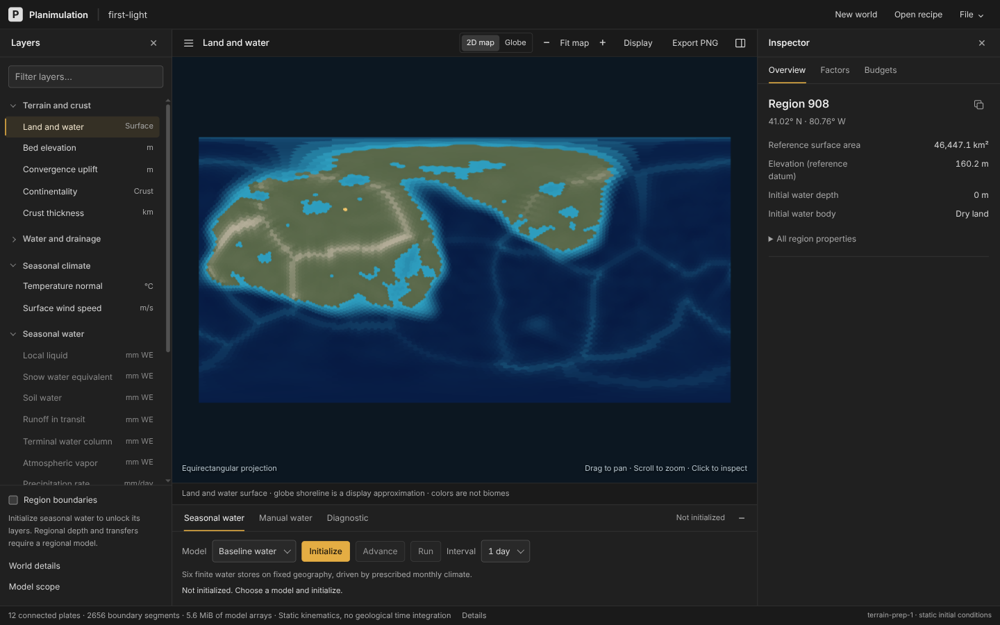

# Desktop workspace

Date: 2026-10-15. Implementation record for the Bruno-inspired workspace direction in [the interface study](ui-bruno-study.md). This changes presentation and navigation, not the simulation's laws, model versions, numerical policies, or save formats.

This is a capture of the running Electron application at 1440×900, using an actual generated world and its region inspector. The earlier study SVG remains a separate composition proposal.

## Structure

The app uses a compact application header, a layer navigator, a flexible map viewport, a persistent inspector, and an experiment dock. The map and inspector have independent space; scrolling inspection values does not scroll the map away. The initial atlas and relief globe use the existing GPU renderer and physical fields.

- **New world** opens the existing recipe editor in a modal. It retains generator selection, seed, resolution, radius, geology parameters, and initial water constraints. Closing it retains the draft. Generation closes the editor and exposes cancellation in the app header.
- **Layers** groups terrain, drainage, climate normals, seasonal water, and diagnostics. A text filter supports keyboard selection. Seasonal-water and diagnostic groups start collapsed. Layer availability follows the accepted model's existing guards.
- **Inspector / Overview** shows the selected region's identity and the current layer's relevant initial-world values. Manual water views promote their displayed depth/body values. Seasonal layers show the same accepted-frame value, unit, and elapsed time as the map's existing display function. All region properties remains available as a disclosure. Seasonal region exchange and basin analysis retain their own contextual sections.
- **Inspector / Factors** shows existing explanations relevant to the selected layer. A layer without a recorded breakdown says so. These are the existing model contributions and recorded relationships, not a new causal inference system.
- **Inspector / Budgets** keeps the exact manual inventory and the approximate or paired seasonal inventory explicitly separate. Refresh exact manual budget retains the native read-only inspection action.
- **Seasonal water** uses one model selector to expose the existing baseline, upslope, precise upslope, regional surface-flow, or unified soil-water initializer. After acceptance, Run/Pause becomes the primary action. Advance and Interval retain their native behavior. Changing the selector never reinterprets an initialized state.
- **Manual water** and **Diagnostic** remain separate experiment tabs. Manual input has no elapsed-time clock; diagnostic diffusion has its own step counter. Unavailable combinations explain why their controls are disabled.
- **File** names recipe, initial-data export, and mode-specific checkpoint operations separately. **Export PNG** remains a map toolbar action. **Display** contains globe exaggeration. Monthly climate-normal controls appear for the temperature and wind layers and retain their independent month selector.
- **World details**, **Model scope**, and status **Details** preserve scientific interpretation and full diagnostic messages without filling the primary map workspace.

## Interaction and state

The layer and inspector panes can be hidden and resized. Their dividers have 10 px pointer targets, keyboard arrow/Home/End controls, and a double-click reset. Widths and group disclosure preferences are bounded and stored under `planimulation.workspace.v1` in local presentation storage. No camera, UI preference, or pane dimension enters a recipe, checkpoint, native command, or initial fingerprint.

At widths up to 1150 px, the inspector becomes an explicitly toggled overlay. At widths up to 760 px, the layers also become an overlay. Selecting a map region reveals the inspector. Escape dismisses an overlay and restores focus to its toggle; the first Escape in a nonempty layer filter clears the query. Hidden panes are inert. Arrow keys navigate tabs and visible enabled layer rows. Ctrl/Cmd+K opens and focuses layer search. Focus is visibly distinct from an active layer or selected tab.

Run/Pause distinguishes an accepted paused frame from an outstanding interval. Stopping scheduling leaves the current request to finish. Controls retain the existing busy guards. Native errors appear above the map with a dismiss action; the footer and status dialog retain the complete message. Cancellation and failed candidate loading preserve the previously accepted world according to the existing native transaction contract.

The dock heading exposes Pause when a running experiment's controls are collapsed or a different experiment tab is selected. Model and interval labels travel with their controls when narrow toolbars wrap. Reaching the existing supported seasonal duration is identified as a limit rather than an unexplained disabled Run button.

An accepted seasonal initialization/step or manual input marks experiment progress unsaved. Successful matching checkpoint saving clears that mark. Diagnostic advancement has a separate dirty flag because neither recipe nor water checkpoints save diagnostic state. Replacing a world requires an explicit decision when such progress exists. Closing or reloading a dirty window is handled through Electron's `will-prevent-unload`; declining keeps the renderer and accepted native world usable. Renderer disposal occurs on actual unload rather than on a canceled close attempt.

## Visual system

Chrome uses neutral graphite surfaces, restrained amber interaction accents, 4 px control corners, 1 px structural dividers, and compact rows. Inter Variable is bundled locally with its SIL Open Font License in `src/renderer/fonts/`; runtime font loading requires no network. Numeric inspection uses tabular figures. Monospace is reserved for the initial fingerprint. Scientific field palettes remain in the existing map renderer.

The interface has no button lift, scaling on press, ornamental gradients, or automatic entrance sequences. Temporary menus and dialogs use shadows to indicate elevation. Reduced-motion preferences disable transitions.

## Map rendering

November 15, 2026. Display settings expose three display-only options, all on by
default:

- **Interpolate between regions.** Continuous layers blend each region center
  with its shared dual corners (mean of incident regions). Categorical layers
  (plates, catchments, water bodies, basins, spill thresholds, plate speed) stay
  whole-region. The shoreline uses a separately relaxed display mask; see
  [water-surface display](water-surface.md#interpolated-display-shoreline).
- **Relief shading.** Land and water and Bed elevation use a north-west
  hillshade from per-region least-squares bed slopes in the local east/north
  frame, scaled so the 90th-percentile dry-land slope shades visibly at any
  resolution. Land treats neighboring water as the water level and vice versa;
  bathymetric slopes are attenuated. The same local shading applies on the
  globe, where geometry still uses the separate vertical exaggeration.
- **Drainage lines.** Catmull-Rom curves follow static bed receivers wherever
  the contributing dry area reaches max(10 mean regions, 100,000 km²), in three
  widths by area. They are drainage potential, not discharge or channels, and
  end at the shared boundary when entering water.

None of these options changes native fields, fingerprints, picking or saved
state. `scripts/render-review.ts` captures flat, globe and zoomed screenshots of
a generated world for visual review.

## UX polish

Follow-up on 2026-10-16: real application inspection identified heavy outer focus outlines on fields and tabs, and no direct copy actions. Keyboard focus now uses a thin inset outline; text fields use their existing border for focus. Mouse clicks on tabs retain their ordinary selected state. Forced-colors mode keeps an explicit system-color focus outline. Control labels avoid accidental text selection; inspection values remain selectable.

The header offers Copy world seed on hover or keyboard focus (always visible for pointers without hover). Overview offers Copy visible region values with labels and units, world identity, current layer, and seasonal model/time when initialized. Expanded properties are included once; collapsed properties and other inspector tabs are omitted. This is a text snapshot of displayed values, not a scientific state export or checkpoint. World details can copy the initial fingerprint, and status Details can copy the full message. Copy feedback stays on the initiating control and resets after two seconds; failures are shown there as well. A bounded, trusted-renderer IPC action writes text through Electron without exposing clipboard reading to the renderer.

The footer formats fractional elapsed days through the existing numeric formatter rather than displaying an unbounded decimal expansion.

Text selection uses the same amber accent with dark foreground text throughout the workspace, including text fields. System contrast mode retains its system highlight colors.

The subsequent [planet navigation increment](globe-navigation.md) adds a surface-relative globe camera, compass, viewport zoom/tilt/reset controls, independent camera poses, and optional space scenery. The map toolbar retains projection, display, and export actions. Viewport keyboard focus uses a compact indicator instead of a perimeter outline.

## Verification

`npm run test:workspace` builds the app and runs focused real-Electron interaction checks. It covers layer filtering and keyboard selection, contextual inspection, pane resizing by mouse and keyboard, pane hiding, display settings, unchanged initial identity under presentation changes, accepted-frame seasonal readings, seasonal initialization/stepping/run/pause, checkpoint save/restore/continuation, canceled world replacement, canceled window closing/reloading, remembered widths/groups after accepted reload, and responsive layouts at 1440, 1280, 1024, 760, and 390 px. Screenshots are written to `artifacts/workspace-*.png` for visual review.

`npm run test:desktop` retains the existing broad native/GPU desktop scenarios. Its UI helper opens the new dialogs, groups, menus, and tabs before acting on controls. The helper accepts replacement prompts only in scenarios that explicitly replace a world. The focused workspace check independently verifies declining replacement.

The workspace check also exercises actual system clipboard writes, failure and retry feedback, keyboard copy activation, feedback reset, expanded-property deduplication, seasonal timestamps on static and seasonal layers, normal text selection, and pointer versus keyboard focus. It saves and restores clipboard contents inside the Electron main process without returning prior clipboard contents to the test process.

Recorded results on Linux, 2026-10-15: the production build and TypeScript check passed. Both `node --import tsx scripts/test-workspace.ts` and `node --import tsx scripts/test-desktop.ts` passed against the built application; the desktop/native initial fingerprint remained `d6044c91`. The wide atlas, selected-region inspector, globe, world editor, seasonal state, and narrow compositions were reviewed from actual screenshots. Core foreground/background contrast pairs were also checked directly from the theme tokens; this is not a claim of comprehensive accessibility certification.

Follow-up results on Linux, 2026-10-16: the production build, TypeScript check, expanded workspace checks, and broad desktop checks passed after the UX polish. The default initial fingerprint remained `d6044c91`. Final region inspection, copy feedback, keyboard focus, the world editor, and narrow layouts were reviewed in actual application captures. The implementation screenshot above was refreshed from this run.

Numerical scientific validation records remain separate. UI checks do not establish climate calibration, long-term numerical stability, or additional model capabilities. Interactive historical replay, multi-world document tabs, and scenario branches remain unimplemented concepts.
